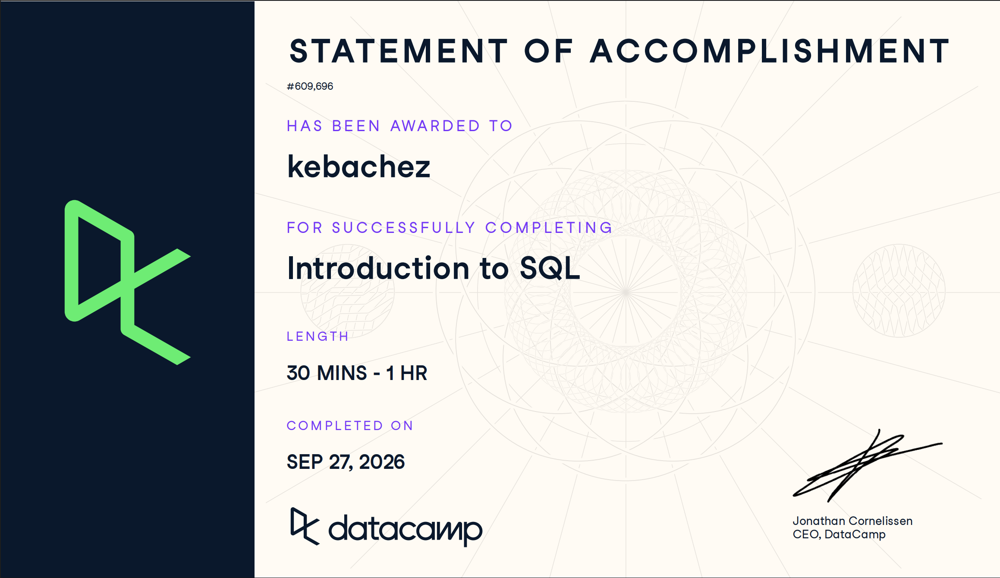

# Course Overview

## Introduction to SQL

The DataCamp **Introduction to SQL** course introduces the fundamentals of working with relational databases and using SQL to access and organize data. Relational databases store information in organized tables, such as customer transaction histories and other large collections of structured data.

## Relational Databases

The course begins by explaining how relational databases are organized. It covers data organization, tables, and best practices for constructing databases. These concepts provide a foundation for understanding how information is stored and connected within a database.

## Writing SQL Queries

The course then introduces SQL queries for selecting information from a database. Through interactive exercises, I practiced retrieving the data I needed and learned how query results can be customized and saved.

## PostgreSQL and SQL Server

The final portion of the course introduces PostgreSQL and SQL Server as two common SQL flavors. The course explains that these systems have different benefits and applications while still using SQL to work with relational databases.

## Overall Course Purpose

Overall, the course provided an introduction to both the theory and practice of SQL. It gave me hands-on experience working with relational databases and provided a foundation that I can build on in future analytics, marketing, and CEP projects.

# Course-Completion Evidence

I completed the DataCamp **Introduction to SQL** course on September 26, 2026.




# Learning Notes and Key Takeaways

## Chapter 1: Introduction to SQL

### Meet Databases & SQL

#### Main Ideas

In this lesson, I learned what databases are and how they are organized using tables. Databases are used to store structured information so that data can be accessed and analyzed efficiently.

I also learned that SQL is used to work with data stored in databases. SQL allows users to retrieve information from tables and interact with organized datasets.

#### Important SQL Concepts

- Databases store organized data.
- Tables contain structured information.
- SQL is used to work with data stored in databases.
- Understanding how tables are structured is important before writing queries.

#### CEP Application

Understanding databases and tables can help me organize and work with marketing data in a CEP project. For example, website analytics, customer information, survey responses, and campaign data can be stored in structured tables that can later be analyzed using SQL.

### Write Your First SQL

#### Main Ideas

In this lesson, I learned how SQL queries can be used to retrieve specific information from database tables. I practiced selecting data, limiting the number of results, sorting records, and identifying top or bottom records.

These techniques are useful because a database may contain a large amount of information, and SQL allows me to focus only on the records that are relevant to the question I am trying to answer.

#### Important SQL Syntax

The topics in this lesson correspond to common SQL commands such as `SELECT`, `LIMIT`, and `ORDER BY`.

```sql
SELECT *
FROM customers
ORDER BY total_spending DESC
LIMIT 5;
```

#### Explanation of the Example

This query retrieves information from the `customers` table. `ORDER BY total_spending DESC` sorts the records from the highest spending amount to the lowest, while `LIMIT 5` returns only the first five records.

This type of query could be used to identify the customers with the highest spending levels.

#### CEP Application

In a digital marketing or CEP project, these SQL skills could help me identify important groups of customers or records. For example, I could sort customers by purchases, engagement, website activity, or another marketing metric and focus on the highest or lowest performing records.

### Complete Your SQL Foundation

#### Main Ideas

In this lesson, I completed the foundation of introductory SQL by learning about unique values, renaming columns, SQL flavors, and how databases operate in practice.

Unique values can help identify the different categories or values that exist within a field. Renaming columns can make query results easier to understand and present.

I also learned that there are different SQL flavors. Although they share many of the same basic ideas, different database systems may have differences in their SQL syntax and features.

#### Important SQL Syntax

Standard SQL commonly uses `DISTINCT` to return unique values and `AS` to rename a column in query results.

```sql
SELECT DISTINCT customer_segment AS segment
FROM customers;
```

#### Explanation of the Example

This query returns the unique customer segments contained in the `customers` table. `DISTINCT` removes duplicate values, while `AS segment` gives the output column a shorter and clearer name.

#### CEP Application

These concepts could be useful when analyzing marketing data because I may need to identify unique customer groups, campaign types, traffic sources, or other categories. Renaming columns can also make tables and reports easier to understand when presenting results to a client or project team.

# Overall Reflection and Future Reference

## Most Useful Skills Learned

The most useful skills I learned were how to retrieve information from database tables, sort results, limit the number of records returned, identify unique values, and rename columns. These skills provide a foundation for working with larger datasets and finding the specific information needed for analysis.

## Most Challenging SQL Concepts

One concept that required more attention was understanding how different SQL commands work together within the same query. I also had to become familiar with the differences between SQL flavors and understand that some commands or syntax may vary depending on the database system being used.

## How SQL Can Support Digital Marketing and CEP Work

SQL can support digital marketing analytics by making it easier to retrieve and organize customer, website, campaign, transaction, and survey data. In a CEP project, SQL could help me identify important patterns, compare groups of customers, examine campaign performance, and prepare data for additional analysis or reporting.

For example, I could use SQL to find highly engaged customers, identify traffic sources, compare customer segments, or retrieve records related to specific marketing activities.

## Concepts I Expect to Review Again

I expect to review SQL query structure, sorting, limiting results, working with unique values, and differences between SQL flavors. As I begin working with more complex databases, I will likely return to these notes as a reference for basic SQL syntax and database concepts.

# Appendix: Publication Links

## GitHub Repository

[GitHub Repository](<https://github.com/kebachez/ibm-6500-sql-learning-portfolio.git>)

## Published Introduction to SQL Report

[Published Introduction to SQL Report](PASTE-YOUR-GITHUB-PAGES-LINK-HERE)